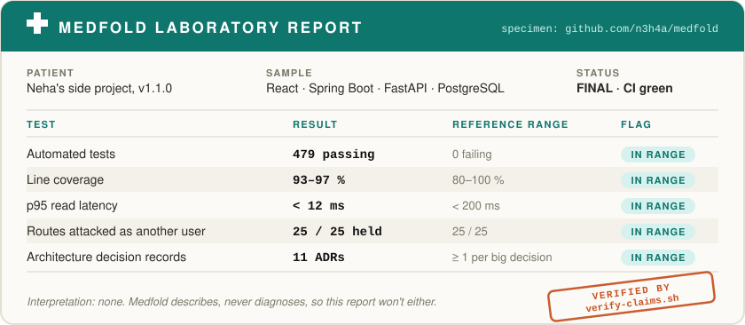
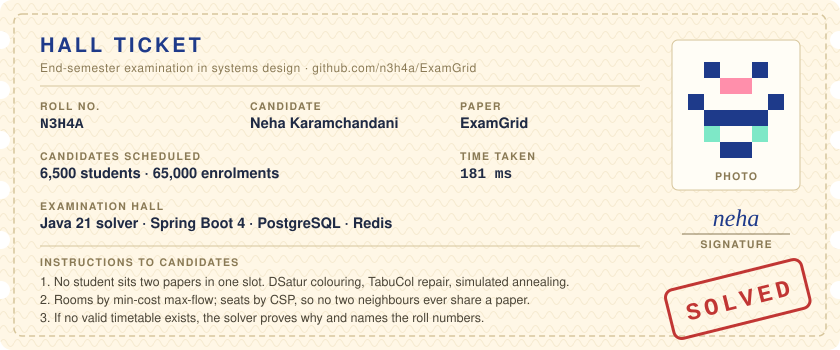

<p align="center">
  
</p>

<p align="center">
  <a href="https://www.linkedin.com/in/nehakaramchandani/"></a>
  <a href="https://drive.google.com/file/d/1Wn0S8QGpAZx_U4xaSKsXx1PFyGHzvjZd/view?usp=drive_link"></a>
  <a href="https://medium.com/@nehakaramchandanii"></a>
  <a href="mailto:nehakaramchandani2005@gmail.com"></a>
</p>

## hi, i'm neha 👋

I'm a 3rd-year IT undergrad. I pick projects that force me into the parts tutorials skip: data that has to stay private, inputs that arrive messy, work too slow for a web request, and an AI that will sometimes be wrong.

So far that's meant a medical-records app that reads lab reports without ever interpreting them, an exam scheduler that plans a whole university's exams in under 200 ms, and a data pipeline that tests its own numbers. Every project comes with its decision records, its bug log, and a way to re-measure each claim it makes.

**Looking for:** data engineering, backend and software engineering roles and internships.

---

## 🧪 things i've built

<a href="https://github.com/n3h4a/medfold"></a>

**[Medfold](https://github.com/n3h4a/medfold)** turns a folder of paper medical reports into a private record you can search and take to any doctor. Uploads go through a Postgres job queue (`FOR UPDATE SKIP LOCKED`), OCR, and then an LLM whose output schema has no field for advice. The "above range" flag is plain arithmetic in Java. A test also attacks every API route as a second user to make sure nobody can read someone else's records.
<br><sub>Java 21 · Spring Boot 4 · FastAPI · Tesseract · Claude API · PostgreSQL 16 · React 19 · Docker · <a href="https://github.com/n3h4a/medfold/blob/main/docs/05-testing/bug-log.md">bug log</a> · <a href="https://github.com/n3h4a/medfold/tree/main/docs/03-design/adr">ADRs</a></sub>

<br>

<a href="https://github.com/n3h4a/ExamGrid"></a>

**[ExamGrid](https://github.com/n3h4a/ExamGrid)** figures out when every exam happens, where every student sits and who invigilates each room. Then it publishes the hall tickets. Under the hood: graph colouring, simulated annealing, min-cost max-flow and a seating constraint solver, all hand-written in plain Java. It runs behind an async API with live progress (SSE). On result day, finding your seat takes one Redis `GET`.
<br><sub>Java 21 · Spring Boot 4 · PostgreSQL · Redis · Flyway · Testcontainers · JMH · jqwik · <a href="https://github.com/n3h4a/ExamGrid/blob/main/docs/benchmarks/README.md">benchmarks</a> · <a href="https://github.com/n3h4a/ExamGrid/tree/main/docs/adr">ADRs</a></sub>

<br>

<a href="https://github.com/n3h4a/spotify-powerbi-dashboard"></a>

**[What Makes a Global Top 50 Hit Last?](https://github.com/n3h4a/spotify-powerbi-dashboard)** takes 18 months of daily charts through a bronze → silver → gold pipeline into a star schema. It answers nine business questions with significance tests, and its model predicts a song's chart life from the first week. A leakage test rebuilds the warehouse with future days added to prove that no feature peeks ahead. There's a [**live dashboard**](https://n3h4a.github.io/spotify-powerbi-dashboard/) too.
<br><sub>Python · DuckDB · SQL · scikit-learn · statsmodels · Power BI (TMDL, 40 DAX measures) · GitHub Actions</sub>

<details>
<summary><b>💿 b-sides</b></summary>
<br>

| | |
|---|---|
| 🏛️ [**SQL Data Warehouse**](https://github.com/n3h4a/sql-data-warehouse-project) | A medallion warehouse in SQL Server that merges ERP and CRM sources into a star schema. Includes ETL procedures, quality checks, a data catalog and 13 analytics reports. |
| ☕ [**DSA in Java**](https://github.com/n3h4a/dsa-practise) | 90+ LeetCode solutions sorted by the pattern behind them, not by problem number. Each one states its approach and complexity, and CI compiles all of them on every push. |

</details>

---

## 🧰 toolbox

| | |
|---|---|
| **backend** |  &nbsp; REST · JWT + RBAC · Flyway · OpenAPI · SSE |
| **data** |  &nbsp; DuckDB · SQL Server · Parquet · star schemas · medallion layers |
| **analytics & ml** | pandas · scikit-learn · statsmodels · SciPy · Power BI (DAX, TMDL) |
| **ai** | Claude API · Tesseract OCR · schema-constrained extraction |
| **frontend** |  |
| **testing** | JUnit · Testcontainers · jqwik · JMH · pytest · Vitest |
| **shipping** |  |

---

## 🛠️ on my workbench

```text
examgrid   ███████░░░  7 / 10 milestones   next → React console, live run views, CI/CD, load tests
medfold    ██████████  v1.1.0 shipped      next → 2FA, doctor share links, FHIR export
```

<details>
<summary><b>🧠 things i'll happily whiteboard for an hour</b></summary>
<br>

- **Postgres doing three jobs.** Queue, search and rate limiter in one database, so an upload and its job commit together.
- **Slow work behind fast APIs.** Return `202`, hand the job to a worker, stream progress, and survive a crash halfway.
- **Algorithms with real users.** Graph colouring and flows for problems people actually have, like exam clashes.
- **LLM guardrails built in.** Give the model nowhere to put the unsafe answer instead of asking it nicely.
- **Data that can't cheat.** Point-in-time features, star schemas, and tests that check for leakage.
- **Writing decisions down.** ADRs that record what I rejected and what my choice costs.

</details>

<details>
<summary><b>📚 reading queue (and the project that needs it)</b></summary>
<br>

| learning | because |
|---|---|
| HL7 FHIR | so Medfold can export records a hospital can import |
| Load testing | to prove ExamGrid survives every student refreshing at once on result day |
| Vision models for documents | to send only the hard-to-read scans to a vision model and keep the rest traceable |
| Two-factor auth flows | to add 2FA to Medfold without weakening its token rotation |

</details>

---

## 📈 activity

<p align="center">
  
  
</p>
<p align="center">
  
</p>
<p align="center">
  <picture>
    <source media="(prefers-color-scheme: dark)" srcset="https://raw.githubusercontent.com/n3h4a/n3h4a/output/snake-dark.svg">
    
  </picture>
</p>

---

<details>
<summary><b>🐛 bug diaries</b></summary>
<br>

- **Every test passed and every document failed.** Java's HTTP client sent an HTTP/2 upgrade header, and the Python service rejected every upload. The test doubles didn't care. Now CI boots the whole Docker stack on every push.
- **A bug you'd never see in a demo.** With two backend instances running, one could "rescue" a job the other was still working on. A row lock and an ownership check fixed it.
- **I once quoted a coverage number measured on the wrong machine.** That's why Medfold has a script that re-checks every number in its README.
- **Unrelated, but SQL found it:** on 21 Apr 2024, Taylor Swift held **30 of the 50** spots on the Global Top 50.

</details>

<br>

<p align="center">
  <sub><code>neha@n3h4a:~$ exit</code></sub><br>
  <sub>Every number on this page is measured in the repo it links to. The README itself isn't unit-tested… yet.</sub><br><br>
  <a href="https://www.linkedin.com/in/nehakaramchandani/">LinkedIn</a> ·
  <a href="https://drive.google.com/file/d/1Wn0S8QGpAZx_U4xaSKsXx1PFyGHzvjZd/view?usp=drive_link">Resume</a> ·
  <a href="https://medium.com/@nehakaramchandanii">Medium</a> ·
  <a href="mailto:nehakaramchandani2005@gmail.com">nehakaramchandani2005@gmail.com</a>
</p>
